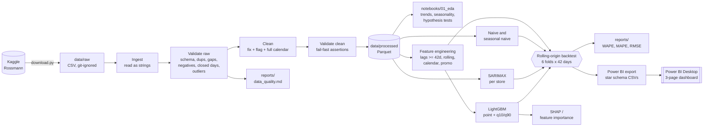
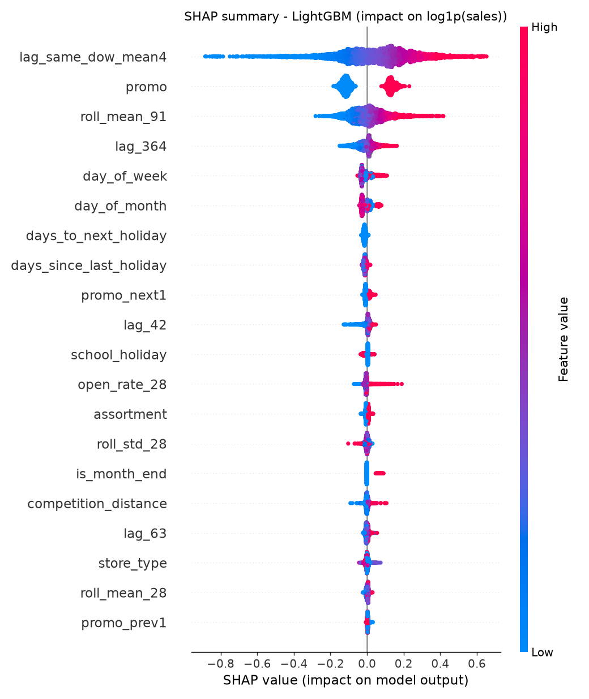
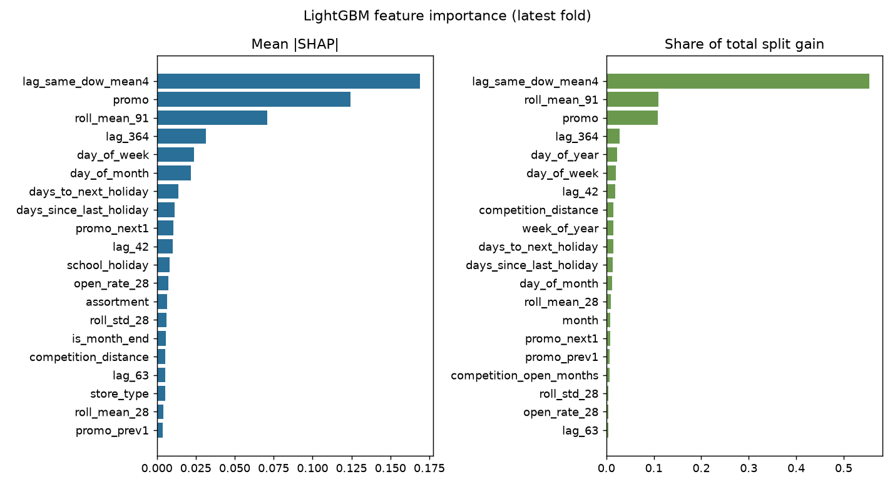

# Retail Demand Forecasting & BI Dashboard

End-to-end demand forecasting on the Kaggle **Rossmann Store Sales** data: a validated data pipeline, exploratory statistics with a real hypothesis test, baseline / statistical / ML forecasting models evaluated with a leakage-free walk-forward backtest, prediction intervals, SHAP explanations, and a star-schema export for a Power BI dashboard.

<!-- BEGIN:HEADLINE -->
> **LightGBM** forecasts 6 weeks of daily sales per store with **WAPE 9.5%** / **MAPE 9.8%** versus **23.6% / 23.6%** for the seasonal-naive baseline (**59.8%** lower WAPE, **58.4%** lower MAPE) in a 6-fold walk-forward backtest over 1,115 stores. Data-quality checks fixed or flagged **35,189** records; **24** automated tests pass, including a no-leakage test.
<!-- END:HEADLINE -->

## Problem

A drugstore chain needs a **6-week, daily, per-store sales forecast** to plan staffing and stock. Sales are driven by a weekly cycle, planned promotions, holidays, store closures and a Christmas peak, and they are measured across a thousand stores of very different size. The goal is to beat naive forecasting methods convincingly, measure that honestly (no look-ahead), quantify the uncertainty, and put the result in front of business users in a dashboard.

<!-- BEGIN:SETUP -->
- Rossmann Store Sales: **1,115 stores**, daily, 2013-01-01 to 2015-07-31 (1,017,209 raw rows; 1,050,330 after filling the calendar).
- Scored on open store-days only; closed days are a known input and forecast as 0.
- Backtest origins: 2014-11-21, 2015-01-02, 2015-02-13, 2015-03-27, 2015-05-08, 2015-06-19.
<!-- END:SETUP -->

## Architecture



## Data-quality findings

<!-- BEGIN:DQ -->
6 issue types had a non-zero count, touching **35,189** records in total (full detail and reasoning: [`reports/data_quality.md`](reports/data_quality.md)).

| Issue | Records | Fix |
|---|---:|---|
| Missing store-days (gaps in the calendar) | 33,121 | Reindexed to a full store x day grid |
| Open=1 but Sales=0 | 54 | Re-labelled as closed (Open=0) |
| Sales outliers (per-store Tukey fence, k=3) | 1,113 | Flagged in `is_outlier`, values kept (see below) |
| Stores with missing CompetitionDistance | 3 | Imputed with the median |
| Stores with unknown competition-open date | 354 | Kept as NaN, flagged `competition_open_since_missing` |
| Promo2 start fields blank while Promo2=0 (structural) | 544 | Filled with 0 (not applicable) |

Checked and **clean** (0 found): Schema / type problems (missing cols, uncoercible values); Duplicate (store, date) rows; Negative sales; Open=0 but Sales>0; Invalid StateHoliday codes; DayOfWeek inconsistent with Date; Non-binary Promo / Open / SchoolHoliday.
<!-- END:DQ -->

The pipeline re-runs every validator on the cleaned panel and **raises** if any fixable issue remains, so a bad cleaning step cannot pass silently.

## Method

* **Leakage control.** One global model is trained per forecast origin *T* and asked about every date in *(T, T+42]*. Every sales lag is therefore at least 42 days (`lag_42/49/56/63`, `lag_364`) and every rolling window is computed on the series shifted by 42 days, so a feature for any target date only uses sales observed on or before *T*. Open flag, promo schedule and holidays are used as *known-in-advance* inputs (the same information Rossmann supplies for the future). `tests/test_features.py` perturbs all sales after *T* and asserts every feature in the forecast window is unchanged, and a companion test proves that check is sensitive.
* **Backtest.** Rolling-origin / walk-forward: for each fold all models are refitted using only data up to the origin. Folds are consecutive, non-overlapping 42-day windows ending at the last date in the data.
* **Baselines.** Naive (last observed open-day value) and seasonal naive (same weekday in the last observed week; falls back to the mean of earlier same-weekdays if that day was closed).
* **Statistical.** Per-store SARIMAX(1,0,1)(1,1,1)<sub>7</sub> with open / promo / holiday regressors. Fitting 1,115 stores x 6 folds is slow, so it runs on a seeded random sample of 60 stores and is compared on that sample.
* **ML.** LightGBM on log1p(sales) with lag, rolling-mean/std, calendar, holiday-distance, promo, promo-2 and store features. Two extra quantile models (10th / 90th percentile) give an 80% prediction interval.
* **Metrics.** WAPE (primary: robust and aggregates to the business total), MAPE and RMSE, computed on open store-days only; bias is also reported.
* **Honest caveat on model selection.** The LightGBM hyper-parameters were fixed in advance and **not tuned** on the backtest folds, so the reported numbers are not inflated by tuning on the test windows. There was also no hold-out beyond the backtest itself.

## Results

<!-- BEGIN:RESULTS -->
Backtest: **6 rolling-origin folds**, each forecasting the next **42 days (6 weeks) daily** for every store; test windows tile 2014-11-22 to 2015-07-31. Metrics are pooled over all open store-days (**226,099** per model). Lower is better. WAPE = sum|error| / sum(actual).

| Model (all 1,115 stores) | WAPE % | MAPE % | RMSE | Bias % | WAPE mean over folds | WAPE std over folds |
|---|---:|---:|---:|---:|---:|---:|
| Naive | 23.2 | 24.7 | 2,311 | -5.2 | 23.2 | 4.9 |
| Seasonal naive (baseline) | 23.6 | 23.6 | 2,426 | -6.7 | 23.6 | 5.5 |
| LightGBM | 9.5 | 9.8 | 1,042 | 0.1 | 9.5 | 2.2 |

**WAPE by fold** (\*SARIMAX only covers the 60-store sample, so its fold numbers are on those stores, not all stores):

| Fold | Test window | Naive | Seasonal naive | SARIMAX* | LightGBM |
|---|---:|---:|---:|---:|---:|
| 1 | 2014-11-22 to 2015-01-02 | 31.8 | 32.2 | 20.9 | 13.2 |
| 2 | 2015-01-03 to 2015-02-13 | 20.8 | 24.8 | 16.5 | 11.4 |
| 3 | 2015-02-14 to 2015-03-27 | 18.4 | 17.9 | 10.0 | 8.2 |
| 4 | 2015-03-28 to 2015-05-08 | 25.4 | 27.2 | 11.9 | 8.1 |
| 5 | 2015-05-09 to 2015-06-19 | 19.8 | 18.5 | 10.6 | 7.8 |
| 6 | 2015-06-20 to 2015-07-31 | 23.3 | 21.3 | 9.9 | 8.5 |

**Head-to-head on the same 60 stores** (the fair way to include SARIMAX, which is fitted per store):

| Model (same 60-store sample) | WAPE % | MAPE % | RMSE | Bias % |
|---|---:|---:|---:|---:|
| Naive | 23.0 | 24.7 | 2,401 | -5.2 |
| Seasonal naive (baseline) | 23.3 | 23.5 | 2,516 | -6.5 |
| SARIMAX (60-store sample) | 13.2 | 13.5 | 1,481 | -0.8 |
| LightGBM | 9.6 | 9.7 | 1,195 | -0.1 |

**Accuracy by forecast horizon** (LightGBM, all folds pooled):

| Horizon week | LightGBM WAPE % | Seasonal-naive WAPE % |
|---|---:|---:|
| 1 | 11.1 | 30.4 |
| 2 | 9.5 | 18.4 |
| 3 | 8.8 | 25.2 |
| 4 | 9.0 | 18.7 |
| 5 | 9.6 | 30.8 |
| 6 | 8.8 | 19.0 |

**Prediction intervals** (quantile LightGBM, 10th-90th percentile, nominal 80%): empirical coverage **70.4%**, mean width **25.2%** of actual sales. Coverage by fold: fold 1: 61.9%, fold 2: 66.7%, fold 3: 72.8%, fold 4: 71.5%, fold 5: 74.4%, fold 6: 73.4%.




<!-- END:RESULTS -->

## Key insights

<!-- BEGIN:INSIGHTS -->
1. **Promotions have a large, highly significant effect on sales.** Within-store, same-weekday, non-holiday comparison across 1,115 stores: promo days sell **39.7%** more (95% bootstrap CI 38.9% to 40.4%; paired t = 87.0, Wilcoxon p = 5.9e-184, Cohen's d_z = 2.61); 100% of stores benefit. The lift is not uniform: it ranges from 20.3% to 42.5% across store types (Kruskal-Wallis p = 1.3e-11). This is observational, not a randomised trial.
2. **What the model relies on.** Top SHAP features: `lag_same_dow_mean4`, `promo`, `roll_mean_91` (together 77% of total split gain). Recent same-weekday level plus the promo schedule carry most of the signal, and the baselines, which ignore the promo calendar, have no access to the second of these.
3. **Consistent, not a lucky split.** LightGBM beats seasonal naive in **6 of 6** folds; fold WAPE ranges from 7.8% (fold 5) to 13.2% (fold 1). The hardest window is fold 1 (test window 2014-11-22 to 2015-01-02, which contains Christmas and New Year; the training data holds only one earlier Christmas).
4. **Horizon.** WAPE is 11.1% in week 1 and 8.8% in week 6 (range 8.8-11.1%), i.e. no monotone degradation with horizon. By design every target day only sees sales at least 42 days old, so near-term days get no fresher data; an origin-anchored model that uses the latest weeks for the first horizon weeks is a possible improvement.
5. **Statistical vs ML.** On the same 60 stores SARIMAX reaches WAPE 13.2% (baseline 23.3%), LightGBM 9.6%. SARIMAX beats the baselines (it takes the promo/open flags as regressors, which they lack) but needs one fit per store per fold; the single global LightGBM is both more accurate and cheaper to run at 1,115-store scale.
6. **The intervals are too narrow.** The nominal 80% interval covers **70.4%** of actuals (lowest in fold 1: 61.9%). Interval quantiles learned from training data typically under-state out-of-sample uncertainty; a conformal recalibration using earlier folds is the natural next step (not done here). Treat the band as a lower bound on uncertainty.
7. **Holidays act mainly through store closures.** Among stores that *are* open on state holidays, sales relative to their own mean are not significantly different (median ratio 1.02 vs 0.97, Mann-Whitney p = 0.48); the forecast effect comes from the (known) open flag. Sundays: only 2.4% of store-days are open.
<!-- END:INSIGHTS -->

## Power BI dashboard

`python -m src.export.powerbi` writes the star schema to [`powerbi/`](powerbi/): `dim_date`, `dim_store`, `dim_model`, `fact_sales_actuals`, `fact_forecasts` (model, fold, forecast, lower/upper 80% interval, actual), `model_metrics` and `feature_importance`. Follow [`powerbi/DASHBOARD_GUIDE.md`](powerbi/DASHBOARD_GUIDE.md) for the relationships, DAX measures (WAPE, forecast vs actual, YoY) and the three pages (Executive Overview, Store Drilldown, Model Performance).

| Executive Overview | Store Drilldown | Model Performance |
|---|---|---|
| _screenshot placeholder_<br>`docs/screenshots/01_executive_overview.png` | _screenshot placeholder_<br>`docs/screenshots/02_store_drilldown.png` | _screenshot placeholder_<br>`docs/screenshots/03_model_performance.png` |

## How to run

```bash
git clone https://github.com/saiswayam2027/demand-forecasting-bi.git
cd demand-forecasting-bi
python -m venv .venv && source .venv/bin/activate      # Windows: .venv\Scripts\activate
pip install -r requirements.txt

# Kaggle data: either configure the kaggle CLI (token at https://www.kaggle.com/settings and accept the
# competition rules at https://www.kaggle.com/c/rossmann-store-sales), or download rossmann-store-sales.zip
# manually into data/raw/. The download step skips itself if the files are already there.
python run_all.py            # download -> pipeline -> tests -> backtest -> export -> notebook -> README tables
# or: make all
```

Individual steps: `python -m src.pipeline.run`, `python -m pytest -q`, `python -m src.models.backtest`, `python -m src.export.powerbi`, `python scripts/build_eda_notebook.py`. A full run takes roughly 10-15 minutes on a laptop (the backtest dominates).

## Repository layout

```
src/pipeline/   download, ingest, validate, clean, run (+ data-quality report)
src/models/     features, baselines, sarima, lgbm, metrics, backtest, explain (SHAP)
src/export/     Power BI star-schema export
notebooks/      01_eda.ipynb (executed; built by scripts/build_eda_notebook.py)
powerbi/        exported CSVs + DASHBOARD_GUIDE.md
reports/        data_quality.md, metrics*.csv|json, figures/
tests/          pytest suite (validation, cleaning, leakage, baselines, metrics)
```

## Limitations and next steps

* Promo-lift is estimated from observational data; promos are scheduled centrally, but it is not a randomised experiment.
* The 80% interval is under-covering (see results); a conformal recalibration using earlier folds is the natural fix.
* Features sit at a 42-day lag for every horizon day. An origin-anchored model (fresh lags for near-term days) could improve weeks 1-2.
* SARIMAX is evaluated on a 60-store sample for runtime; hierarchical reconciliation (store -> region -> total) was not attempted.
* Rossmann's data ends in 2015-07; no external regressors (weather, local events) are used.
